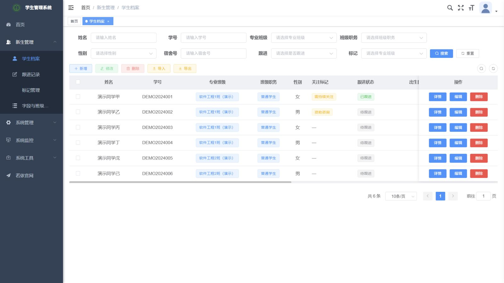
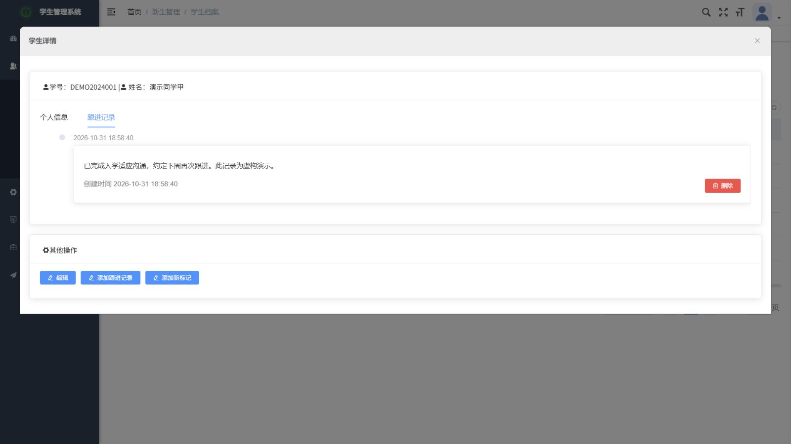
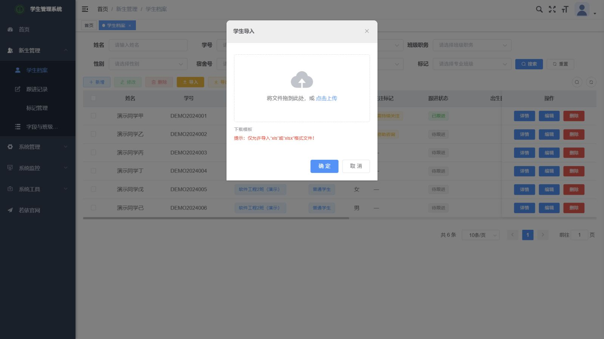

# 新生信息与跟进管理系统

基于 **RuoYi-Vue / Spring Boot / Vue 2 / MyBatis / MySQL / Redis** 的新生管理项目，包含管理网页、Java 后端及 uni-app 移动端源码。

此仓库由本地保存的 2024 年项目归档整理而来。保留原框架与业务代码作者署名；本次整理补齐缺失业务表、修复运行问题并加入虚构演示数据。它不代表全部代码均为仓库维护者独立原创，也不包含真实学校学生数据库。

## 主要功能

- 学生档案：按姓名、学号、专业班级、宿舍、标记和跟进状态筛选，支持新增、修改、详情与删除。
- 关注标记：添加不同关注类型，重复标记校验，删除后同步更新学生标记摘要。
- 跟进记录：记录沟通内容，支持图片附件，增删记录后更新跟进状态。
- Excel：导入模板、字典值转换、学生批量导入和导出。
- 权限：JWT 登录、菜单权限、班级范围检查。辅导员示例账号只能维护一班学生，标记和跟进维护由管理员演示。
- 宿舍查询接口：同时提供姓名及演示身份编号后返回宿舍信息。

## 功能截图

学生档案与筛选：



学生详情中的持续跟进：



Excel 导入与模板下载：



截图均来自本地运行页面，所有记录均为虚构数据。

## 本地运行

已验证环境：Windows、JDK 8、Maven 3.9.13、Node 20.19、MySQL 8、Redis。旧版 Vue CLI 使用的 Webpack 4 在 Node 20 下需要 OpenSSL 兼容参数，已写入 npm scripts。

1. 创建一个新的空数据库 `freshman_management_demo`（字符集 `utf8mb4`），创建仅能访问该演示库的数据库用户。按顺序导入 `database/01-demo.sql`、`database/02-quartz.sql`。脚本用于空库，不要向已有业务库重复执行。
2. 启动一个独立的本机 Redis 实例：`redis-server --bind 127.0.0.1 --port 16380 --save ""`。
3. 在 PowerShell 中设置当前终端环境变量，然后启动后端：

```powershell
$env:DB_USER = '你的演示库用户'
$env:DB_PASSWORD = '你的演示库密码'
$env:DB_NAME = 'freshman_management_demo'
$env:JWT_SECRET = [guid]::NewGuid().ToString('N') + [guid]::NewGuid().ToString('N')
cd backend
mvn -DskipTests package
java -jar ruoyi-admin/target/ruoyi-admin.jar
```

4. 另开终端启动管理网页：

```powershell
cd frontend
npm ci --ignore-scripts --no-audit --no-fund
npm run dev
```

访问 `http://127.0.0.1:18801`。后端默认 `http://127.0.0.1:18800`，开发代理已指向本机，保留验证码验证。

- 管理员：`admin` / `Demo123456`
- 一班辅导员：`counselor` / `Demo123456`
- 宿舍接口演示：`POST /system/student/dormitory`，JSON `{"studentName":"演示同学甲","idCard":"DEMO-ID-001"}`。

这些是公开演示账号，仅适合本机测试。配置默认绑定回环地址；上线前需替换账号、更新依赖并完成完整安全检查。

可选环境变量：`DB_HOST`、`DB_PORT`、`REDIS_PORT`、`SERVER_PORT`、`UPLOAD_PATH`；前端代理支持 `BACKEND_URL`。数据库密码和 JWT 密钥没有写入仓库。

## 验证

```powershell
cd frontend
npm run build:prod
# 回到仓库根目录，保持后端、MySQL 和独立 Redis 正在运行
python -m pip install -r scripts/requirements.txt
$env:REDIS_CLI = 'redis-cli' # 或 redis-cli.exe 的完整路径
python scripts/smoke_test.py
```

集成脚本已在本机通过 12 组检查：验证码登录/JWT、管理列表、伪造角色参数后的班级隔离、跨班详情拒绝、宿舍查询、图片上传与读取、学生增改查、标记及重复校验、跨学生跟进删除后的状态一致性、Excel 导出、模板导入、测试记录清理。测试通过专用 Redis 读取测试验证码；网页正常登录仍要求用户填写验证码。

测试会创建并删除以 `SMOKE-` / `IMPORT-` 开头的临时记录，**仅针对可丢弃的本机演示库运行**。详情见 [验证记录](docs/verification.md)。

## 移动端范围

`mobile/` 是 HBuilderX 格式的 uni-app 项目，配置地址已改为本机后端，移除了原 AppID。可用 HBuilderX 导入，选择运行到 Web 或配置自己的小程序/App 环境。真机访问时需自行配置可达的后端地址。

管理网页与 Java 后端已经运行并验证；移动端的运行/发行状态以 [验证记录](docs/verification.md) 为准，不将源码存在等同于真机功能全部通过。

## 整理时修复的问题

- 原归档只有若依基础 SQL：按实体和 MyBatis 映射重建 5 张业务表，加入标记唯一约束、学号唯一约束及关联记录级联删除。
- 修复学生新增语句末尾字段缺少逗号、宿舍查询缺少结果映射的问题，并拒绝空条件宿舍查询。
- 服务端从当前登录身份计算班级范围，不再信任前端 `roleId`；对学生详情、修改、删除和导入补充班级检查。
- 重建标记摘要，修复 `null` 拼接、数值比较和批量删除取错标签的问题。
- 修复跨学生批量删除跟进后，只更新首个学生状态的问题；导入失败时回滚本批数据。
- 移除原远程数据库地址、数据库密码和 AppID；保留框架许可证、作者注释。

字段显示权限沿用原项目设计，属于界面控制，不宣称为接口字段脱敏机制。当前依赖和框架版本较旧，本仓库定位为项目展示与学习演示。

## 来源与许可

框架来自 RuoYi-Vue（若依）与 RuoYi-App，原 MIT 许可证分别保留在 [backend/LICENSE](backend/LICENSE)、[mobile/LICENSE](mobile/LICENSE)。业务文件保留原作者注释（如 `xzr`）。本次新增的演示脚本、数据库重建与文档整理不改变原文件的作者归属。
